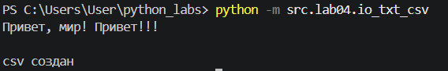
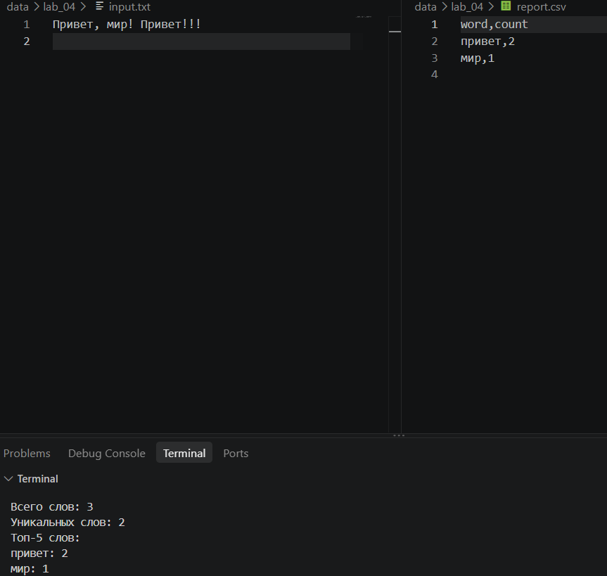

# ЛР4 — Файлы: TXT/CSV и отчёты по текстовой статистике
## Задание A — модуль `src/lab04/io_txt_csv.py`
### Реализует функции для работы с файлами: чтение текстового файла целиком в указанной кодировке (read_text, по умолчанию utf-8; если файл не найден или кодировка не подходит - исключение FileNotFoundError / UnicodeDecodeError «всплывает» наружу без перехвата) и запись списка строк в CSV-файл с разделителем , (write_csv). Перед записью write_csv проверяет, что все строки в rows имеют одинаковую длину (и, если задан header, что его длина совпадает с длиной строк) - иначе поднимается ValueError. Родительская папка для выходного файла создаётся автоматически, если её ещё нет. Расположен в src/lab04/io_txt_csv.py.


## Задание B — скрипт `src/lab04/text_report.py`
### Реализует функции для чтения текстовых файлов целиком в заданной кодировке (`read_text`, по умолчанию `utf-8`; ошибки `FileNotFoundError` и `UnicodeDecodeError` не перехватываются и передаются наружу) и сохранения данных в CSV-файл с разделителем `,` (`write_csv`). Перед записью проверяется одинаковая длина всех строк в `rows` и соответствие длины `header`, если он указан, иначе возникает `ValueError`. Если выходная директория отсутствует, она создаётся автоматически. Расположен в `src/lab04/io_txt_csv.py`.


## Обработка краевых случаев
### • **Пустой файл** — в `report.csv` записывается только заголовок `word,count`, без данных. В консоли отображаются нулевое количество слов и уникальных слов, а после `Топ-5:` список остаётся пустым.
### • **Отсутствие входного файла** — программа выводит сообщение `Ошибка: файл не найден: <путь>` и завершает выполнение.
### • **Кодировка файла** — по умолчанию используется `UTF-8`. Для чтения файлов в другой кодировке, например `cp1251`, необходимо изменить значение константы `ENCODING` в начале `text_report.py`.
### • **Изменение путей** — расположение входного и выходного файлов определяется константами `INPUT_PATH` и `OUTPUT_PATH` в начале `text_report.py`. Для работы с другими файлами нужно указать соответствующие пути в этих переменных.

## Способ запуска text_report.py
Запуск выполняется из корня репозитория (там, где лежит папка src/), с помощью флага -m:
```
python -m src.lab04.text_report
```
Скрипт не принимает аргументов командной строки — все настройки (входной файл, выходной файл, кодировка) заданы константами в начале `src/lab04/text_report.py.` Чтобы обработать другой файл или другую кодировку, нужно отредактировать эти константы и запустить скрипт заново той же командой.
