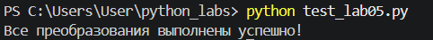
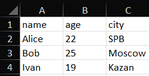

# ЛР5 — JSON и конвертации (JSON↔CSV, CSV→XLSX): Техническое задание

## Задание A — JSON ↔ CSV

```python
import json
import csv
from pathlib import Path


def json_to_csv(json_path: str, csv_path: str) -> None:
    try:
        json_path = Path(json_path)
        csv_path = Path(csv_path)

        if json_path.suffix.lower() != ".json":
            raise ValueError("Входной файл должен быть JSON")

        if csv_path.suffix.lower() != ".csv":
            raise ValueError("Выходной файл должен быть CSV")

        with json_path.open("r", encoding="utf-8") as file:
            data = json.load(file)

        if not isinstance(data, list) or not data:
            raise ValueError("JSON пустой или содержит неверную структуру")

        if not all(isinstance(item, dict) for item in data):
            raise ValueError("JSON должен содержать список словарей")

        fieldnames = list(data[0].keys())

        if not fieldnames:
            raise ValueError("В JSON отсутствуют поля")

        for item in data:
            for key in item:
                if key not in fieldnames:
                    fieldnames.append(key)

        csv_path.parent.mkdir(parents=True, exist_ok=True)

        with csv_path.open("w", newline="", encoding="utf-8") as file:
            writer = csv.DictWriter(file, fieldnames=fieldnames)
            writer.writeheader()
            writer.writerows(data)

    except FileNotFoundError:
        print(f"Ошибка: файл {json_path} не найден")
        raise
    except json.JSONDecodeError:
        print("Ошибка: JSON имеет неправильный формат")
        raise ValueError("Некорректный JSON") from None
    except PermissionError:
        print("Ошибка: нет доступа к файлу")
        raise
    except ValueError as error:
        print(f"Ошибка: {error}")
        raise


def csv_to_json(csv_path: str, json_path: str) -> None:
    try:
        csv_path = Path(csv_path)
        json_path = Path(json_path)

        if csv_path.suffix.lower() != ".csv":
            raise ValueError("Входной файл должен быть CSV")

        if json_path.suffix.lower() != ".json":
            raise ValueError("Выходной файл должен быть JSON")

        with csv_path.open("r", newline="", encoding="utf-8") as file:
            reader = csv.DictReader(file)

            if not reader.fieldnames or not all(reader.fieldnames):
                raise ValueError("CSV пустой или не содержит заголовок")

            if len(reader.fieldnames) != len(set(reader.fieldnames)):
                raise ValueError("Названия столбцов должны быть уникальными")

            data = list(reader)

        if not data:
            raise ValueError("CSV не содержит строк с данными")

        json_path.parent.mkdir(parents=True, exist_ok=True)

        with json_path.open("w", encoding="utf-8") as file:
            json.dump(data, file, ensure_ascii=False, indent=2)

    except FileNotFoundError:
        print(f"Ошибка: файл {csv_path} не найден")
        raise
    except PermissionError:
        print("Ошибка: нет доступа к файлу")
        raise
    except ValueError as error:
        print(f"Ошибка: {error}")
        raise
```

## Задание B — CSV → XLSX

```python
import csv
from pathlib import Path
from openpyxl import Workbook


def csv_to_xlsx(csv_path: str, xlsx_path: str) -> None:
    try:
        csv_path = Path(csv_path)
        xlsx_path = Path(xlsx_path)

        if csv_path.suffix.lower() != ".csv":
            raise ValueError("Входной файл должен быть CSV")

        if xlsx_path.suffix.lower() != ".xlsx":
            raise ValueError("Выходной файл должен быть XLSX")

        with csv_path.open("r", newline="", encoding="utf-8") as file:
            rows = list(csv.reader(file))

        if not rows or not rows[0] or not any(cell.strip() for cell in rows[0]):
            raise ValueError("CSV пустой или не содержит заголовок")

        if len(rows) < 2:
            raise ValueError("CSV не содержит строк с данными")

        xlsx_path.parent.mkdir(parents=True, exist_ok=True)

        workbook = Workbook()
        worksheet = workbook.active
        worksheet.title = "Sheet1"

        for row in rows:
            worksheet.append(row)

        for column in worksheet.columns:
            max_length = 0
            column_letter = column[0].column_letter

            for cell in column:
                if cell.value is not None:
                    max_length = max(max_length, len(str(cell.value)))

            worksheet.column_dimensions[column_letter].width = max(
                8, max_length + 2
            )

        workbook.save(xlsx_path)
        workbook.close()

    except FileNotFoundError:
        print(f"Ошибка: файл {csv_path} не найден")
        raise
    except PermissionError:
        print("Ошибка: нет доступа к файлу")
        raise
    except ValueError as error:
        print(f"Ошибка: {error}")
        raise
```

## тесты
[Папка с результатами](../../data//lab05/out/)



скрин из Excel:




### Обработка ошибок

В программе предусмотрены следующие проверки:

• отсутствие входного файла — FileNotFoundError;

• неправильное расширение файла — ValueError;

• пустой JSON или CSV — ValueError;
 
• неправильная структура JSON — ValueError;

• отсутствие заголовка CSV — ValueError.

Для обработки ошибок используются проверки условий и исключения raise. При запуске тестов применяется try-except.

### Установка зависимостей

Для работы используются стандартные модули `json`, `csv`
и `pathlib`, а для Excel — библиотека `openpyxl`.

```
python -m pip install -r requirements.txt
```
