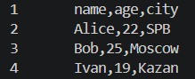
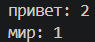
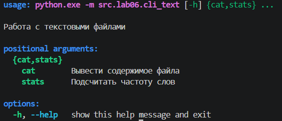
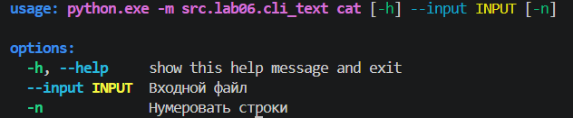
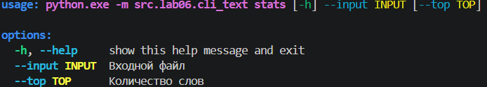
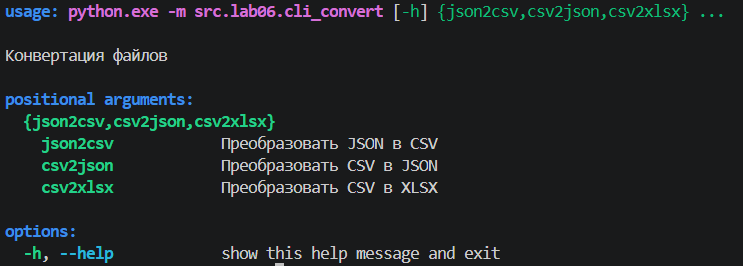
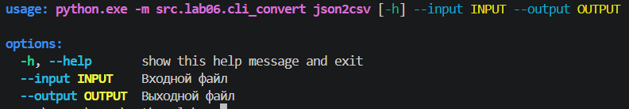
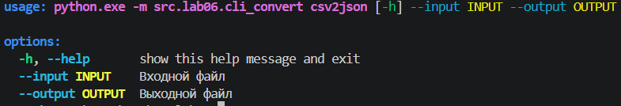
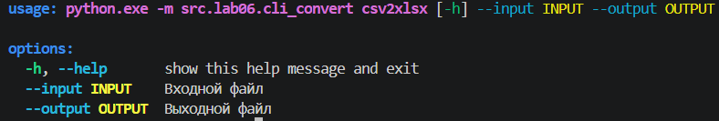

# Лабораторная работа № 6

## Описание

В лабораторной работе реализованы консольные команды для обработки текстовых файлов и преобразования данных между форматами JSON, CSV и XLSX.

## Реализованные команды

- `cat` — вывод содержимого файла; параметр `-n` включает нумерацию строк.
- `stats` — подсчёт частоты слов и вывод наиболее часто встречающихся слов.
- `json2csv` — преобразование JSON в CSV.
- `csv2json` — преобразование CSV в JSON.
- `csv2xlsx` — преобразование CSV в XLSX.

Для обработки текста используются функции из `src/lib/text.py`, а для чтения и преобразования файлов — функции из предыдущих лабораторных работ.

## Установка

Из корневой папки проекта выполнена установка в режиме разработки:

```powershell
python -m pip install -e .
```

## Сценарии запуска

Команды ниже запускаются из корневой папки проекта. Для команд `cat` и `stats` используется запуск через Python-модуль, чтобы избежать конфликта имени `cat` со встроенной командой PowerShell.

### 1. Вывод содержимого файла с нумерацией строк

```powershell
python -m src.lab06.cli_text cat --input data/lab05/samples/people.csv -n
```

Ожидаемый результат: содержимое CSV-файла выводится в терминал, строки пронумерованы.



### 2. Подсчёт частоты слов

```powershell
python -m src.lab06.cli_text stats --input data/lab_04/input.txt --top 5
```

Ожидаемый результат: выводятся топ(до пяти пунктов) наиболее часто встречающихся слов и количество их повторений.



### 3. Преобразование файлов

Преобразование CSV в JSON

```powershell
python -m src.lab06.cli_convert csv2json --input data/lab05/samples/people.csv --output data/lab06/out/people_converted.json
```

Преобразование JSON в CSV:

```powershell
python -m src.lab06.cli_convert json2csv --input data/lab06/out/people_converted.json --output data/lab06/out/people_roundtrip.csv
```

Преобразование CSV в XLSX:

```powershell
python -m src.lab06.cli_convert csv2xlsx --input data/lab05/samples/people.csv --output data/lab06/out/people.xlsx
```

Ожидаемый результат: команды выполняются без ошибок и создают выходные файлы по указанным путям.

 


### 4. Проверка справки

Справка текстового модуля:

```powershell
python -m src.lab06.cli_text --help
```



Справка команды `cat`:

```powershell
python -m src.lab06.cli_text cat --help
```



Справка команды `stats`:

```powershell
python -m src.lab06.cli_text stats --help
```



Справка модуля преобразования:

```powershell
python -m src.lab06.cli_convert --help
```



Справка команды `json2csv`:

```powershell
python -m src.lab06.cli_convert json2csv --help
```



Справка команды `csv2json`:

```powershell
python -m src.lab06.cli_convert csv2json --help
```



Справка команды `csv2xlsx`:

```powershell
python -m src.lab06.cli_convert csv2xlsx --help
```



Ожидаемый результат: для каждой команды отображаются описание и доступные аргументы.


## Проверка результата

Работа проверяется по следующим критериям:

- команда `cat` выводит содержимое файла с нумерацией строк;
- команда `stats` выводит заданное количество наиболее частых слов;
- команды преобразования создают выходные файлы;
- справка доступна для команд и подкоманд.
