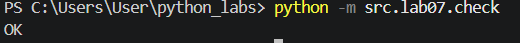
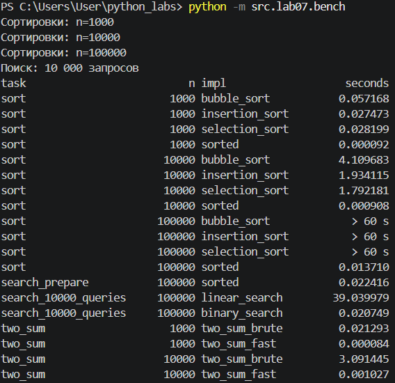

# ЛР7 — Поиск, сортировка и измерение времени

## Описание работы

В лабораторной работе реализованы базовые алгоритмы поиска и сортировки, а также два решения задачи Two Sum. Выполнена проверка корректности на случайных данных и проведено сравнение времени работы алгоритмов.

## search.py

Реализованы четыре функции:

- `linear_search(nums, x)` — возвращает индекс первого вхождения элемента или `-1`, если элемент отсутствует.
- `binary_search(sorted_nums, x)` — выполняет поиск в отсортированном списке и возвращает индекс элемента или `-1`.
- `two_sum_brute(nums, target)` — перебирает пары элементов и возвращает индексы двух чисел с заданной суммой.
- `two_sum_fast(nums, target)` — решает ту же задачу за один проход с использованием словаря.

Оба решения Two Sum возвращают `None`, если подходящей пары нет. При нескольких правильных парах допускается любой ответ.

## sorting.py

Реализованы три сортировки:

- `bubble_sort(nums)` — сортировка пузырьком: соседние элементы меняются местами, если расположены в неправильном порядке.
- `insertion_sort(nums)` — сортировка вставками: очередной элемент вставляется в подходящее место отсортированной части списка.
- `selection_sort(nums)` — сортировка выбором: минимальный элемент оставшейся части перемещается на текущую позицию.

Каждая функция создаёт копию исходного списка и возвращает новый отсортированный список. Исходные данные не изменяются. Готовые функции сортировки внутри этих алгоритмов не используются.

## check.py

Проверка корректности выполняется командой из корневой папки проекта:

```bash
python -m src.lab07.check
```

Выполняются:

- 100 случайных прогонов для каждой из трёх сортировок;
- 100 случайных прогонов проверки поиска;
- 100 случайных прогонов проверки Two Sum;
- 5 дополнительных примеров Two Sum.

Всего выполняется 500 случайных прогонов и 5 фиксированных примеров. Один прогон может содержать несколько проверок.

Результаты сортировок сравниваются со встроенной функцией `sorted`. Дополнительно проверяется, что исходный список не изменился.

Линейный поиск сравнивается с результатом `list.index`. Для бинарного поиска проверяется найденное значение или ответ `-1`, если числа нет в списке.

Для Two Sum проверяются согласованность наличия ответа у двух реализаций, правильность индексов и соответствие суммы заданному значению. Среди дополнительных примеров есть пустой список, список из одного элемента, повторяющиеся числа и отсутствие подходящей пары.

При несовпадении возникает `AssertionError` с данными примера.

Результат запуска — расхождений не найдено:

```text
OK
```



## bench.py

Запуск бенчмарка из корневой папки проекта:

```bash
python -m src.lab07.bench
```

Для измерений используется `timeit`. Выполняются три замера, в таблицу записывается минимальное время. Данные генерируются до начала измерений. Для воспроизводимости установлен `random.seed(42)`.

Сравниваемые алгоритмы получают одинаковые входные данные:

- сортировки проверяются на списках из 1 000, 10 000 и 100 000 элементов;
- линейный и бинарный поиск выполняют 10 000 одинаковых запросов к списку из 100 000 элементов;
- Two Sum проверяется на списках из 1 000 и 10 000 элементов с гарантированно существующей парой в конце списка.

Предварительная сортировка для бинарного поиска измеряется отдельно.

Для ограничения долгих сортировок используется отдельный процесс. Если очередной результат не получен за 60 секунд, процесс останавливается и в таблицу записывается `> 60 s`.

Результаты выводятся в терминал и сохраняются в `data/lab07/bench.csv` через функцию `write_csv` из ЛР4.

## Результаты бенчмарка

Время указано в секундах. Значения округлены до шести знаков после точки.

| Задача | n | Реализация | Время, с |
|---|---:|---|---:|
| Сортировка | 1 000 | bubble_sort | 0.057168 |
| Сортировка | 1 000 | insertion_sort | 0.027473 |
| Сортировка | 1 000 | selection_sort | 0.028199 |
| Сортировка | 1 000 | sorted | 0.000092 |
| Сортировка | 10 000 | bubble_sort | 4.109683 |
| Сортировка | 10 000 | insertion_sort | 1.934115 |
| Сортировка | 10 000 | selection_sort | 1.792181 |
| Сортировка | 10 000 | sorted | 0.000908 |
| Сортировка | 100 000 | bubble_sort | > 60 |
| Сортировка | 100 000 | insertion_sort | > 60 |
| Сортировка | 100 000 | selection_sort | > 60 |
| Сортировка | 100 000 | sorted | 0.013710 |
| Подготовка для бинарного поиска | 100 000 | sorted | 0.022416 |
| 10 000 запросов | 100 000 | linear_search | 39.039979 |
| 10 000 запросов | 100 000 | binary_search | 0.020749 |
| Two Sum | 1 000 | two_sum_brute | 0.021293 |
| Two Sum | 1 000 | two_sum_fast | 0.000084 |
| Two Sum | 10 000 | two_sum_brute | 3.091445 |
| Two Sum | 10 000 | two_sum_fast | 0.001027 |



## Выводы по работе

Пузырёк, вставки и выбор на случайных данных имеют квадратичную сложность: при увеличении размера списка в 10 раз ожидается рост объёма работы примерно в 100 раз. В проведённых измерениях время пузырька выросло примерно в 72 раза, вставок — в 70 раз, выбора — в 64 раза. Точные отношения отличаются от теоретической оценки из-за условий выполнения и особенностей данных; O-нотация описывает порядок роста, а не точное количество секунд. На 100 000 элементов все три сортировки превысили установленный лимит ожидания результата. Встроенный `sorted` с оценкой O(n log n) справился со всеми размерами. Теоретически при переходе от 1 000 к 10 000 элементов ожидается рост примерно в 13.3 раза; в измерениях получено около 9.8 раза. В задаче Two Sum решение со словарём оказалось значительно быстрее перебора пар: его средняя сложность O(n) вместо O(n²), но для хранения словаря требуется дополнительная память O(n).

Бинарный поиск требует предварительной сортировки, поскольку только порядок элементов позволяет отбрасывать половину области поиска. Для одного запроса подготовка может оказаться дороже линейного прохода, но при многократном поиске в неизменном списке её стоимость окупается. В измерениях сортировка и 10 000 бинарных запросов вместе заняли около 0.043165 секунды, а линейный поиск — 39.039979 секунды. Проверка корректности выполнила 500 случайных прогонов и 5 дополнительных примеров Two Sum, расхождений не обнаружено. Проверка Two Sum была дополнена случаями отсутствия ответа и проверкой правильности индексов и суммы.