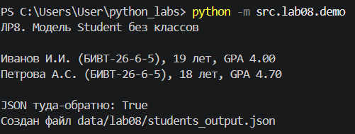
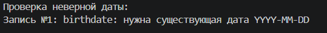
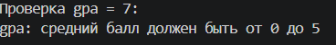

# Лабораторная работа № 8

## Описание

Модель данных без классов: запись `Student` как словарь, валидация и сериализация в JSON.
Реализованы основное задание и задания со звёздочкой: обновление записи и чтение CSV.
Используются только модули стандартной библиотеки Python.

## Структура записи

`STUDENT_FIELDS = ("fio", "birthdate", "group", "gpa")` задаёт фиксированный набор ключей.

| Поле | Тип | Проверка |
| --- | --- | --- |
| `fio` | `str` | Непустая строка после `strip()` |
| `birthdate` | `str` | Существующая дата строго `YYYY-MM-DD`, не в будущем |
| `group` | `str` | Непустая строка после `strip()` |
| `gpa` | `float` | Число от 0 до 5; `int` преобразуется в `float`, `bool` запрещён |

`date.fromisoformat()` проверяет существование даты. Сравнение с `isoformat()` дополнительно
отсекает записи вроде `20070920`, которые некоторые версии Python тоже принимают.

## Функции

| Функция | Назначение |
| --- | --- |
| `make_student` | Проверяет поля, убирает пробелы по краям ФИО и группы, создаёт словарь |
| `validate_student` | Проверяет, что ключи совпадают со `STUDENT_FIELDS`, затем проверяет значения; не изменяет запись |
| `student_age` | Считает полные годы; если день рождения ещё не наступил, вычитает один год |
| `format_student` | Выводит фамилию с инициалами, группу, возраст и GPA с двумя знаками |
| `student_to_dict` | Проверяет запись и возвращает копию через `copy()` |
| `student_from_dict` | Извлекает обязательные поля и передаёт их в `make_student`; лишние входные поля игнорирует |
| `update_student` | Меняет поля в копии, проверяет её и возвращает новую запись |
| `students_to_json` | Проверяет записи и сохраняет массив в UTF-8 с `ensure_ascii=False`, `indent=2` |
| `students_from_json` | Загружает массив и проверяет каждый объект через `student_from_dict` |
| `students_from_csv` | Читает CSV через `DictReader`, преобразует GPA в число и создаёт записи |

Поверхностной копии здесь достаточно: все значения записи — строки и числа, вложенных изменяемых объектов нет.
Для неизвестного поля в `update_student` возникает `KeyError`, для неверного значения — `ValueError`.

## Запуск

Все команды выполняются из корня репозитория, где находятся папки `src` и `data`.

```bash
python -m src.lab08.demo
```

Программа загружает `data/lab08/students_input.json`, выводит студентов,
сохраняет `students_output.json`, читает его обратно и сравнивает записи.
Затем показывает ошибки неверной даты и GPA, расчёт возраста, обновление записи и загрузку CSV.
Пути определяются относительно файла программы, поэтому данные сохраняются в папку проекта.

### Пример использования функций

```python
from datetime import date
from src.lab08.models import (
    make_student, validate_student, student_age, format_student,
    student_to_dict, student_from_dict, update_student,
)
from src.lab08.serialize import students_to_json, students_from_json, students_from_csv

s1 = make_student("Иванов Иван Иванович", "2007-09-20", "БИВТ-26-6-5", 4)
validate_student(s1)  # Возвращает None, если всё верно.
print(student_age(s1, date(2026, 9, 19)))  # 18
print(student_age(s1, date(2026, 9, 20)))  # 19
print(format_student(s1))  # Возраст зависит от текущей даты.
d = student_to_dict(s1)
print(d is s1)  # False
print(student_from_dict(d) == s1)  # True
s2 = update_student(s1, gpa=4.8)
print(s1["gpa"], s2["gpa"])  # 4.0 4.8
students_to_json([s1, s2], "data/lab08/example.json")
print(students_from_json("data/lab08/example.json") == [s1, s2])  # True
print(len(students_from_csv("data/lab08/students_input.csv")))  # 2
```

## JSON до и после преобразования

Первая запись из входного файла:

```json
{
  "fio": "Иванов Иван Иванович",
  "birthdate": "2007-09-20",
  "group": "БИВТ-26-6-5",
  "gpa": 4
}
```

После загрузки и сохранения (`int` преобразован в `float`):

```json
{
  "fio": "Иванов Иван Иванович",
  "birthdate": "2007-09-20",
  "group": "БИВТ-26-6-5",
  "gpa": 4.0
}
```

Оба файла содержат массив из двух объектов. Кириллица сохраняется читаемой.
Повторная загрузка выходного файла возвращает равные исходным записи.

## Политика обработки ошибок

Выбрана **strict**: первая битая запись останавливает загрузку с `ValueError`.
Сообщение содержит номер записи, начиная с 1, и причину. Частичный список не возвращается.
Отсутствующий файл вызывает `FileNotFoundError`, неверный синтаксис JSON — `JSONDecodeError`
(это подкласс `ValueError`). Если в корне JSON не массив, возникает `ValueError`.

Файл `students_bad.json` содержит дату `2003-02-30`. Результат:

```text
Запись №1: birthdate: нужна существующая дата YYYY-MM-DD
```

При попытке создать запись с `gpa=7`:

```text
gpa: средний балл должен быть от 0 до 5
```

В демонстрации ошибки перехватываются, чтобы показать обе проверки за один запуск.
Внутри функций модели неверные данные всегда вызывают исключение.

## Дополнительное задание: CSV

Заголовок файла: `fio,birthdate,group,gpa`. `DictReader` возвращает строки,
поэтому `students_from_csv` выполняет `row["gpa"] = float(row["gpa"])`
до вызова `student_from_dict`. В конструкторе строковый GPA не принимается.
При ошибке CSV загрузка также останавливается; сообщение содержит номер строки с учётом заголовка.

## Результаты запуска

На 04.11.2026 Иванову 19 лет, Петровой 18 лет. JSON туда-обратно даёт `True`.
Обновление GPA создаёт отдельный словарь, исходный GPA остаётся `4.0`.
Из CSV загружаются две записи.

### Скриншоты запуска

После запуска `python -m src.lab08.demo` нужно сохранить скриншоты в `images/lab08/`.
На первом должна быть видна загрузка студентов и `JSON туда-обратно: True`,
на втором — ошибка неверной даты, на третьем — ошибка `gpa = 7`.
Ссылки ниже начнут отображаться после добавления файлов.







## Вывод

Создана модель студента с фиксированной структурой без классов. Проверка данных
выполняется при создании и загрузке записей. Реализованы обмен данными через JSON и CSV,
вычисление возраста и обновление записи без изменения исходного словаря.
