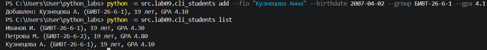
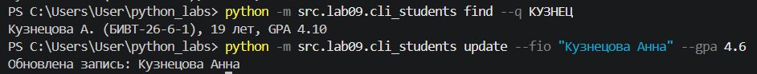
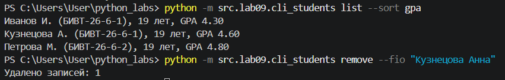
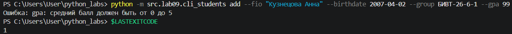

# ЛР9 — CSV-хранилище студентов и CLI

## Цель работы

Реализовать добавление, чтение, обновление и удаление записей студентов в CSV. Консольная программа вызывает функции хранилища через подкоманды `argparse`.

## Хранилище и результаты

- [`group.py`](group.py) создаёт CSV по явному вызову `ensure_storage(path)`, читает записи через `csv.DictReader` и сохраняет их через `csv.DictWriter`. Путь передаётся первым аргументом каждой функции хранилища.
- [`cli_students.py`](cli_students.py) реализует подкоманды `add`, `list`, `find`, `update` и `remove`. Для вывода записей используется `format_student` из ЛР8.
- [`students.csv`](../../data/lab09/students.csv) хранится в UTF-8 с заголовком `fio,birthdate,group,gpa`. При чтении GPA преобразуется в `float`, а запись проверяется через `student_from_dict` из ЛР8. Отсутствующий или неверный заголовок и строки с неправильным числом столбцов отклоняются.

При `list` и `find` хранилище не изменяется. Если файла ещё нет, эти команды возвращают пустой список записей. Сортировки по ФИО и GPA идут по возрастанию. Поиск по подстроке учитывает совпадения в любом регистре. `update` меняет первую запись с указанным ФИО, а `remove` удаляет все записи с таким ФИО и выводит их количество.

Команды запускаются из корня репозитория. По умолчанию используется `data/lab09/students.csv`. Чтобы прочитать тот же файл через явный путь, поставьте `--db` перед подкомандой.

```powershell
python -m src.lab09.cli_students --db data/lab09/students.csv list
```

## Сценарий из шести команд

В начале в базе две записи, приведённые в разделе «Итоговый CSV». Сценарий добавляет третью запись, меняет её GPA с 4.10 на 4.60 и затем удаляет её. Возраст в выводе рассчитывается на дату запуска.

### 1. Добавление

```powershell
python -m src.lab09.cli_students add --fio "Кузнецова Анна" --birthdate 2007-04-02 --group БИВТ-26-6-1 --gpa 4.1
```

```text
Добавлен: Кузнецова А. (БИВТ-26-6-1), 19 лет, GPA 4.10
```

### 2. Список без сортировки

```powershell
python -m src.lab09.cli_students list
```

```text
Иванов И. (БИВТ-26-6-1), 19 лет, GPA 4.30
Петрова М. (БИВТ-26-6-2), 19 лет, GPA 4.80
Кузнецова А. (БИВТ-26-6-1), 19 лет, GPA 4.10
```

### 3. Поиск по подстроке

```powershell
python -m src.lab09.cli_students find --q КУЗНЕЦ
```

```text
Кузнецова А. (БИВТ-26-6-1), 19 лет, GPA 4.10
```

### 4. Обновление GPA

```powershell
python -m src.lab09.cli_students update --fio "Кузнецова Анна" --gpa 4.6
```

```text
Обновлена запись: Кузнецова Анна
```

### 5. Список с сортировкой по GPA

```powershell
python -m src.lab09.cli_students list --sort gpa
```

```text
Иванов И. (БИВТ-26-6-1), 19 лет, GPA 4.30
Кузнецова А. (БИВТ-26-6-1), 19 лет, GPA 4.60
Петрова М. (БИВТ-26-6-2), 19 лет, GPA 4.80
```

### 6. Удаление

```powershell
python -m src.lab09.cli_students remove --fio "Кузнецова Анна"
```

```text
Удалено записей: 1
```

## Проверка неверного GPA

```powershell
python -m src.lab09.cli_students add --fio "Кузнецова Анна" --birthdate 2007-04-02 --group БИВТ-26-6-1 --gpa 99
$LASTEXITCODE
```

```text
Ошибка: gpa: средний балл должен быть от 0 до 5
1
```

Сообщение об ошибке выводится в `stderr`, программа возвращает код `1`. Содержимое CSV остаётся прежним.

## Итоговый CSV

```csv
fio,birthdate,group,gpa
Иванов Иван,2007-10-10,БИВТ-26-6-1,4.3
Петрова Мария,2007-05-21,БИВТ-26-6-2,4.8
```

## Скриншоты

Добавление и список без сортировки.



Поиск и обновление.



Список с сортировкой и удаление.



Ошибка при добавлении записи с неверным GPA.



## Теория

CRUD объединяет четыре операции с данными. Create добавляет запись, Read читает список или ищет по нему, Update меняет запись, Delete удаляет её.

Изменяющие операции читают весь CSV в список словарей, меняют список и записывают его обратно. CSV хранит последовательность строк, поэтому при изменении одной записи файл здесь перезаписывается целиком. Общий путь передаётся явно, поэтому одни и те же функции можно использовать с разными CSV-файлами.

`DictReader` возвращает текстовые значения. Преобразование GPA в число даёт числовую сортировку и позволяет применить валидацию из ЛР8. `newline=""` передаёт обработку переводов строки модулю `csv`, а UTF-8 сохраняет кириллицу в ФИО и названиях групп.
